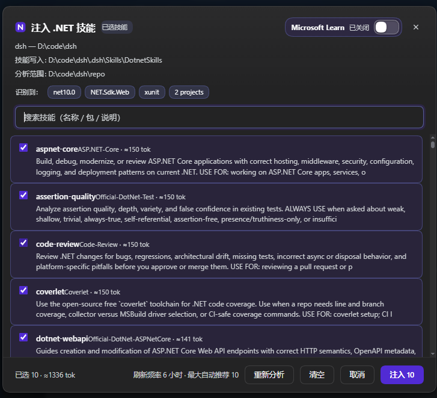
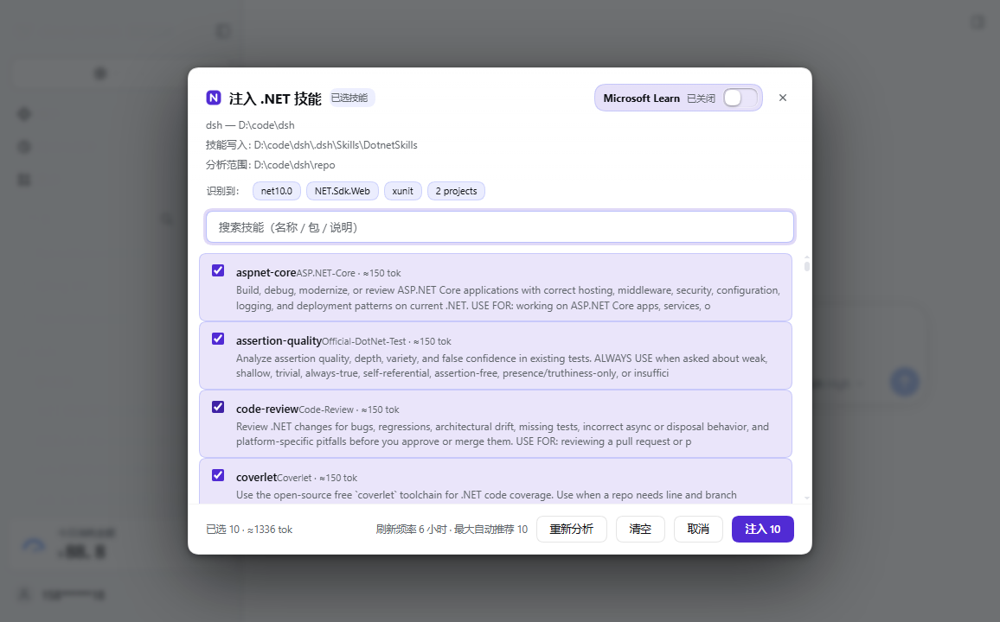
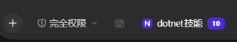

# dsh-dotnet-skills

面向项目的 .NET 技能注入插件，为 DeepSeek Harness 而生。composer 上的一个按钮会读取当前项目，让**当前模型**从 203 个目录技能里挑出真正合适的，只把那些复制进项目；另外可按工作目录开启 Microsoft Learn MCP 服务器并自动准备 `mslearn` CLI。

英文版见 [README.md](./README.md)。

不在用户技能根目录做任何全局镜像：换一个项目、换一个用户，都看不到这个项目的选择。

## 工作流程

```text
composer 按钮（dotnet技能）
  ├─ 事实      本地采集，精确：目标框架、包引用、SDK 版本、
  │            结构信号（Program.cs、razor、xaml、proto、Dockerfile、
  │            workflows、appsettings…）、top using/namespace、README 开头
  ├─ 判断      一次后台 ctx.llm 调用：事实 + 完整目录 → ≤ N 个技能，
  │            每个带一句理由，且必须落到上面的事实上
  └─ 注入      在项目里放两份真实副本（见"目录布局"）
```

挑选结果按 `(目录 head, 项目事实, 界面语言)` 缓存 30 分钟；点「重新分析」会绕过缓存并显示等待状态。如果项目里已经有注入，打开面板**不会**调用模型，只展示当前选择。

## 界面截图

| 深色主题 | 浅色主题 |
|---|---|
|  |  |


## 技能目录：官方 .NET 技能的超集

目录来自 [`managedcode/dotnet-skills`](https://github.com/managedcode/dotnet-skills)：203 个技能，分五个集合（Tools、Frameworks、Testing、Platform、Libraries）。

它是**微软官方 .NET 技能库 [`dotnet/skills`](https://github.com/dotnet/skills) 的超集**：官方发布的 **108** 个技能在此以同名全部存在，另外还有 **95** 个社区技能（撰写本文时对照 `dotnet/skills@main` 核对）。官方集合中的技能没有任何删减或改名，两个源可以互换而不损失覆盖范围。

只有项目真正需要的技能会被复制进项目；目录本身保留在 `$DSH_HOME/vendor/dotnet-skills` 下，按配置的间隔刷新。若想跟踪别的来源（包括直接使用 `dotnet/skills`），改 `repoUrl` 即可。

## 环境要求

| 项 | 要求 |
|---|---|
| DeepSeek Harness | `>=0.2.2-rc.1 <0.3.0`，通过 `engines.dsh` 声明——不在该范围的宿主会直接拒绝安装，而不是装上半残 |
| Node.js | 跟随运行中的 DSH（22+） |
| DSH 进程 PATH 中有 `git` | 用于拉取目录；可用 `gitCommand` 覆盖 |
| 网络 | 目录需要 `github.com`；仅在开启 Learn MCP 时才访问 `learn.microsoft.com` |
## 目录布局

```text
<项目>/.dsh/
├── Skills/DotnetSkills/<技能>/…   本插件拥有的受管仓库
├── skills/<技能>/…               DSH 真正发现的副本（技能根只扫一层）
└── dotnet-skills.json            清单：指纹、归属、learnMcp
```

Windows 上 `.dsh/Skills` 与 `.dsh/skills` 是同一个目录，所以受管仓库实际位于 `.dsh/skills/DotnetSkills/`；DSH 会忽略这个容器目录（它下面没有直接的 `SKILL.md`）。

两份一起写、一起删；第二份从第一份复制，所以即使 catalog checkout 被删除，项目里的技能依然可用。

## 保持更新

宿主按定时器刷新 catalog checkout（默认 6 小时，另在启动后不久执行一次）。当拉取到的 head 变化时，本插件写过的所有项目都会被刷新：指纹变化的技能在两份副本里重写，上游已消失的技能被删除。项目根记录在 `$DSH_HOME/dotnet-skills.projects.json`。

## Microsoft Learn

面板右上角的胶囊开关控制公共的 Microsoft Learn MCP 服务器（`https://learn.microsoft.com/api/mcp`），**按工作目录生效**。选择写入项目清单；进程级的 `@deepseek-ai/dsh-mcp-client` 子插件在「至少一个已知项目需要」时挂载，最后一个关掉时卸载。打开时会确保全局安装 `@microsoft/learn-cli`（`mslearn`），先检测再安装。工具以 `mcp__microsoft-learn-cli__*` 出现。

## 工具

`dotnet_skills` —— 同一份目录的模型侧入口：

| 动作 | 结果 |
|---|---|
| `find` 带 `query` | 按名称 / 包 / 描述搜索目录 |
| `find` 不带 `query` | 返回项目事实与当前注入，不做规则猜测 |
| `add` | 追加技能，记录为 `model` 归属 |
| `remove` | 只删除 `model` 归属的技能，并报告保留的 `user` 项 |
| `probe` | 跑一次面板所用的模型挑选并打印原始结果（诊断用） |

## 配置

**插件 → 已安装 → dsh-dotnet-skills** 会根据 `Config` schema 渲染面板的两个开关；保存经配置编辑器写入，会重启该插件。

| 键 | 默认 | 含义 |
|---|---|---|
| `intervalHours` | `6` | 目录刷新间隔：`6`、`12`、`24`、`72`、`168`（6 小时 / 12 小时 / 1 天 / 3 天 / 1 周） |
| `selectMaxSkills` | `10` | 每个项目最多挑选多少技能，`1`–`50` |
| `repoUrl` / `branch` | managedcode/dotnet-skills，`main` | 目录来源 |
| `runOnStart` / `startDelaySeconds` | `true`，`20` | 启动后刷新一次，延迟多少秒 |
| `checkoutDir` | `$DSH_HOME/vendor/dotnet-skills` | 浅克隆位置 |
| `selectTimeoutMs` | `45000` | 单次面板分析超时 |

`gitCommand` 不在表单里；当 `git` 不在 DSH 进程的 PATH 上时，在 profile 的 patch 中设置。

## HTTP 接口（同源，仅 JSON）

| 路由 | 方法 | 用途 |
|---|---|---|
| `/dsh-dotnet-skills/state?sessionId=&lang=&refresh=1` | GET | 项目事实、模型挑选与理由、目录、当前注入（`refresh=1` 重跑模型） |
| `/dsh-dotnet-skills/apply` | POST | `{sessionId, skills[], lang}` → 替换选择（面板代表人类） |
| `/dsh-dotnet-skills/clear` | POST | `{sessionId, lang}` → 移除本插件拥有的一切 |
| `/dsh-dotnet-skills/count?sessionId=` | GET | 只返回注入数量——读一次清单，不扫描项目、不调用模型；composer 徽标轮询它 |
| `/dsh-dotnet-skills/settings` | GET/POST | 读取或保存两个开关 |
| `/dsh-dotnet-skills/learn` | POST | `{sessionId, enabled}` → 按项目的 Microsoft Learn 开关 |

所有路由都会拒绝浏览器标记为跨站的调用（Sec-Fetch-Site: cross-site / same-site，或 Origin 与 Host 不匹配）；写操作另外要求 JSON content-type。DSH 窗口与本地工具不带这些头，正常放行。

## 归属

清单为每个条目记录注入者：`user`（composer 面板）或 `model`（`dotnet_skills add`）。`remove` 只删 `model` 条目，因此模型能撤销自己的改动，而不会删掉人类的选择。

## 语言

按钮、浮窗、设置卡片跟随 DSH 的界面语言自动切换，**运行中切换也立即生效**（`<html lang>` 变化 + `languagechange` 事件）。判定顺序：`<html lang>` → `navigator.language` → 英文。插件管理器里的标题与简介来自 `locale/zh.json` 与 `locale/en.json`，同样按界面语言取用。

## 已知限制

- DSH 只扫描一层技能根，因此必须有扁平的 `.dsh/skills/<技能>` 副本；嵌套容器不会被识别。
- 一次面板分析消耗一次辅助模型请求（事实 + 目录约 7k 输入 token，输出 ≤700）；30 分钟内重复打开不花钱。
- 挑选由模型完成，本地规则只负责采集事实。没有项目文件的异常布局（生成代码等）会让它缺少依据。
- MCP 服务器是进程级共享的（只要有项目需要就挂载），按项目的隔离体现在工具与选择上，而不是 socket 层面。

## 开发

```bash
node test/smoke.mjs    # 事实采集、模型输出解析、归属保护
node test/layout.mjs   # 双份副本、目录同步、清空
```
